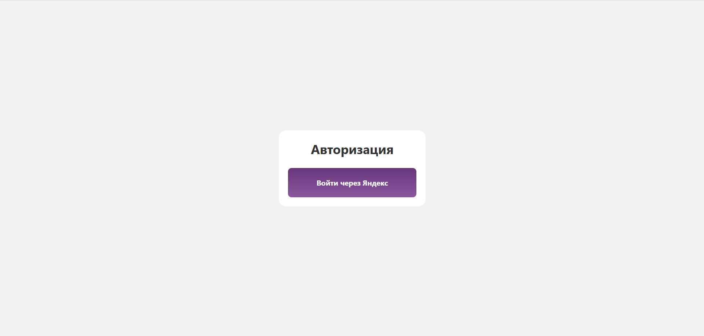
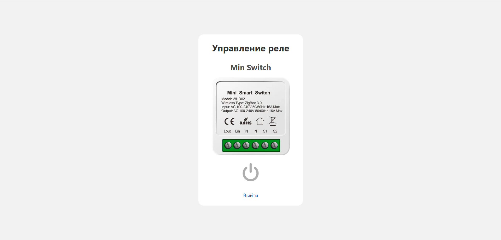
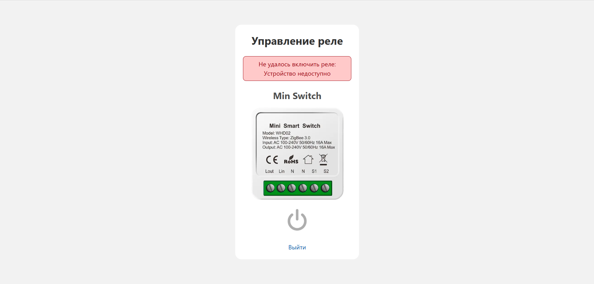

# Smart Relay

A web application for controlling relays (smart sockets and switches) via [Yandex Smart Home](https://yandex.ru/iot/).

## How it works

1. The user signs in via Yandex OAuth and is redirected back to the app
2. The app exchanges the authorization code for a token and displays the list of relays from the account
3. Relays can be turned on and off directly from the interface

The token is kept in the session cookie, so the app does not need a database. Logging out revokes the token at Yandex, so a copied cookie stops working too.

## Error handling

- Timeouts, network failures and HTTP errors from Yandex are shown to the user instead of an error page
- Device errors from the API are shown as readable messages, for example "Устройство недоступно" for `DEVICE_UNREACHABLE`
- An expired or revoked token ends the session and sends the user back to the login page

## Requirements

- Ruby 3.3.12
- Rails 8.1

## Setup

**1. Create an application in Yandex OAuth**

Go to [oauth.yandex.ru](https://oauth.yandex.ru) and create an application of the **For user authorization** type («Для авторизации пользователей»). The type cannot be changed after registration, and an application created for API access may have no Redirect URI setting.

Request the `iot:view` and `iot:control` permissions, select the **Web services** platform («Веб-сервисы»), and add a Redirect URI for each environment:

```
http://localhost:3000/auth/yandex/callback
https://your-domain.example/auth/yandex/callback
```

**2. Fill in `.env`**

```
YANDEX_CLIENT_ID=...
YANDEX_CLIENT_SECRET=...
```

**3. Install dependencies and run**

```bash
bundle install
bin/dev
```

The application will be available at `http://localhost:3000`.

## Testing

Tests are written with [RSpec](https://rspec.info/). Requests to Yandex are stubbed with [WebMock](https://github.com/bblimke/webmock), so no credentials or network access are needed.

```bash
bundle exec rspec
```

The suite has 79 examples:

- `spec/services` — the Yandex Smart Home API client: responses, device errors, network failures
- `spec/requests` — relay pages, login and session expiry

## Screenshots

**Login**


**Relay Control**


**Relay Error**


## Stack

- Ruby on Rails 8.1 — backend
- Hotwire Turbo — page navigation
- Tailwind CSS 4 — styles
- Yandex Smart Home API — device control
- Yandex OAuth 2.0 — authentication
- RSpec and WebMock — testing
